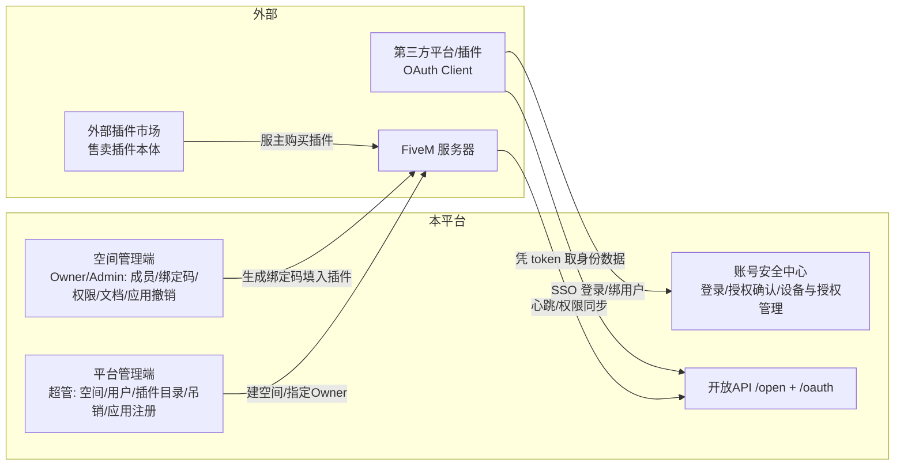
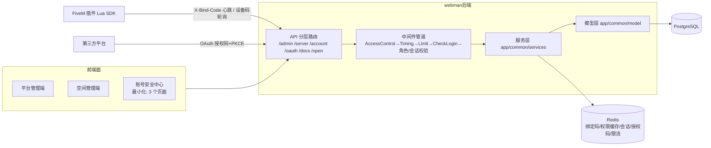
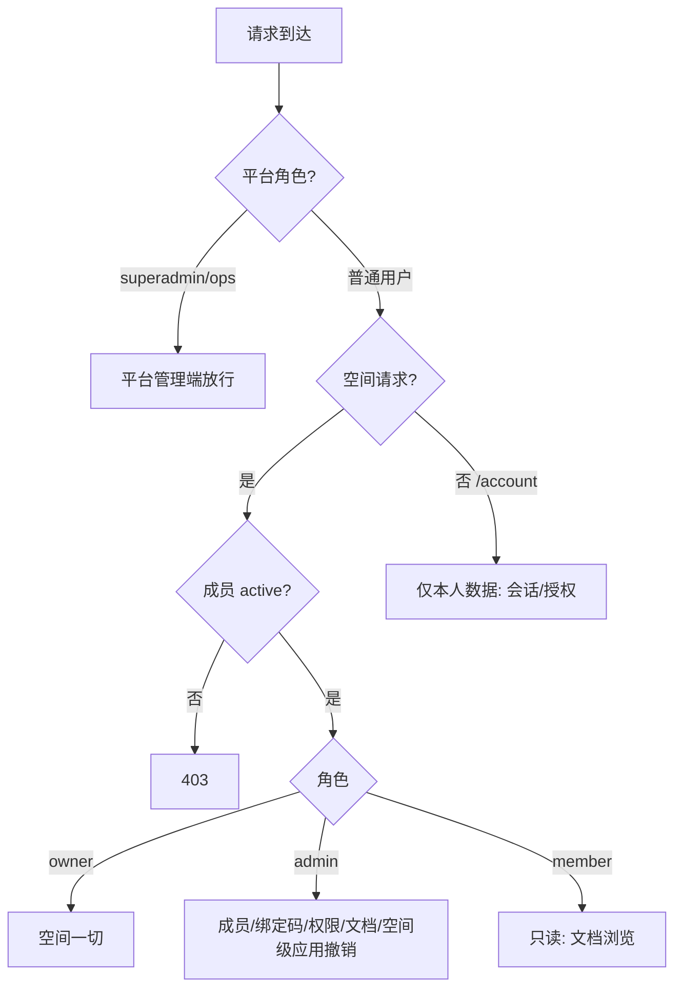
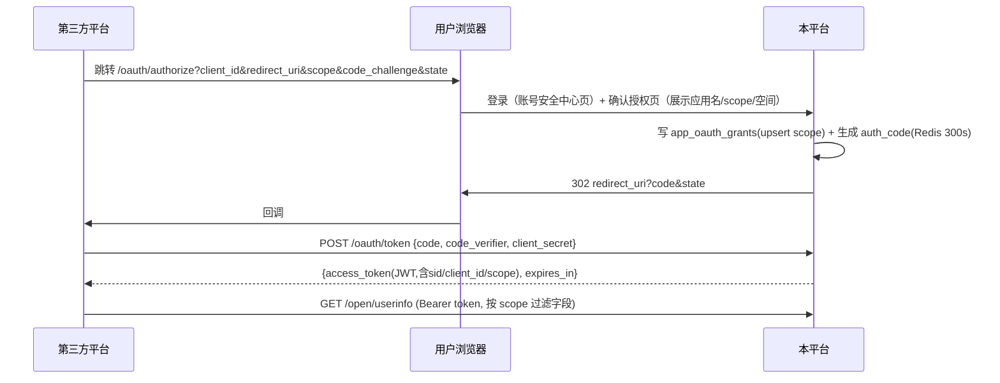

# EXRE 社区 B2B2C 平台设计蓝图

> 版本：v0.3（2026-10-17，按需求方第二、三轮意见修订）
> 基于现有 webman 后端（workerman 常驻内存 / PostgreSQL / Redis / JWT）设计，遵循项目现有代码约定：`success()/fail()` 响应、`app/common` 共享层、`app/<模块>/XxxController.php` 控制器、显式路由注册。

**v0.3 修订要点**（相对 v0.2）：
- 新增 **SSO 身份服务**：平台作为 OAuth2 提供方，第三方平台与插件以"应用"身份接入登录并绑定用户；应用（client）注册与对接**仅平台超管可操作**；空间管理员与用户仅有**撤销权**
- 新增**会话/令牌管理**：每次登录（密码 / SSO / 插件）落一条会话记录，用户可在账号安全中心查看并撤销任意设备 token
- **不做历史数据兼容**：现库为测试数据，结构可推倒重建；上线前 `pg_dump` 备份、仅迁移有用数据（`app_users` 直接改最终结构，无 md5/bcrypt 渐进窗口）
- 为承载 SSO 确认页与 token 撤销，设**最小账号安全中心**（登录/授权确认/设备管理），仍不做玩家业务门户

**v0.2 修订要点**（保留）：定位为外部售卖插件的云端配套服务方（无商店/订单）；仅平台管理端 + 空间管理端；插件绑定码（自由生成、一插件一码、可重置、可吊销）；游戏内绑定码 + Lua SDK；QQBot/TxAdmin 自营私有。

---

## 1. 定位与角色模型

| 层 | 主体 | 在系统中的形态 | 谁管理 |
|---|---|---|---|
| **B1 平台** | EXRE 社区本身 | 平台管理端 + SSO 身份服务 | 超级管理员 |
| **B2 空间** | 注册进来的 FiveM 服务器主体 | `服务器账号`（一个独立"空间"） | 平台超管创建，空间 Owner/Admin 管理 |
| **C 用户** | 玩家/社区成员 | `用户账号`（`app_users`） | 平台 + 空间管理员；仅通过**账号安全中心**与**SSO 授权页**接触系统 |
| **第三方应用** | 外部平台 / 插件 | `OAuth Client`（`app_oauth_clients`） | **仅平台超管**注册与对接 |

**平台为插件提供什么服务**（绑定码开通后）：许可校验与心跳、成员功能权限下发、在线文档、（后续）云端数据同步；**为第三方提供什么**（SSO 授权后）：用户基础信息与游戏标识、（按 scope）插件权限等只读身份数据。

**自营边界**：QQBot WebHook、TxAdmin 白名单仅服务 EXRE 自营服务器，保持现有实现，不空间化、不对外暴露。



---

## 2. 总体架构



### 2.1 webman 模块划分

| 路由前缀 | 控制器目录 | 面向 | 说明 |
|---|---|---|---|
| `/admin/*` | `app/admin/` | B1 平台超管/运营 | 空间、用户、插件目录、绑定码监管、**第三方应用注册**、审计 |
| `/server/*` | `app/server/` | B2 空间 Owner/Admin | 成员、游戏绑定、绑定码、插件权限、空间文档、**应用授权撤销（空间级）** |
| `/account/*` | `app/account/` | C 用户（仅安全中心） | 登录态下的设备/会话管理、第三方授权管理、改密 |
| `/oauth/*` | `app/oauth/` | 浏览器/插件/第三方 | SSO 授权页、授权码、设备码、令牌签发与校验 |
| `/docs/*` | `app/docs/` | 登录用户 | 文档浏览 API（v1 无独立 UI，管理端内嵌预览） |
| `/open/*` | `app/open/` | FiveM 插件进程 | 机器对机器 API，`X-Bind-Code` 鉴权，不走 CheckLogin |
| （现有）`/user/*` | `app/user/` | 所有账号 | 注册/登录收编进 `/account`，旧路由保留到重构完成 |

新增中间件（`app/common/middleware/`）：
- `PlatformAdmin`：校验 `platform_role ∈ {superadmin, ops}`
- `ServerMember`：解析 `{sid}`，挂 `$request->server_role` / `$request->server_member`
- `ServerApiKey`：`/open/*` 按 `X-Bind-Code` 定位绑定记录并校验 `server_key_hash`
- 会话校验并入 `CheckLogin`：JWT 内含 `sid`（会话 id），Redis 会话必须 active——撤销 token 即删会话，立即生效

---

## 3. 权限模型（三层，固定三档 + 应用权限边界）



**第三方应用权限三原则**（对应备注 1-1/1-2）：
1. **client 注册、密钥重置、scope 变更、上下架——只有平台超管**（`/admin/clients/*`）
2. **用户**可在账号安全中心撤销自己授予某应用的授权（吊销该应用名下自己的全部 token，下次需重新授权）
3. **空间管理员**可撤销"挂在本空间"的插件类应用继续获取本空间信息的权限（断开 client↔空间 关联，该应用对本空间数据立即不可见）

---

## 4. 数据库设计

> 约定：`app_` 前缀、`SERIAL` 主键、时间戳 `VARCHAR(50)`、模型 docblock 逐字段中文注释。
> **数据策略（已确认）**：不兼容历史数据。建库脚本直接产出最终结构；上线前对现测试库 `pg_dump` 备份一次，仅人工迁移有用数据。

### 4.1 app_users 最终结构（直接重建，无兼容层）

| 字段 | 类型 | 注释 |
|---|---|---|
| `id` | SERIAL PK | 用户唯一标识 |
| `email` | VARCHAR(255) UNIQUE NOT NULL | 登录邮箱（唯一约束补上） |
| `username` | VARCHAR(64) | 显示昵称 |
| `password_hash` | VARCHAR(255) | 密码哈希（`password_hash()` bcrypt，注册即新算法） |
| `avatar` | VARCHAR(255) | 头像地址，默认 `/app/user/default-avatar.png` |
| `qq` | VARCHAR(20) UNIQUE NULL | 联系 QQ（注册可空；清理历史占位值 123456789） |
| `level` | INTEGER DEFAULT 0 | 用户等级（预留） |
| `platform_role` | VARCHAR(20) DEFAULT '' | 平台角色：'' / ops / superadmin |
| `ban` | INTEGER DEFAULT 0 | 封禁标记：0 正常 / 1 封禁（封禁=拒绝登录+冻结全部会话） |
| `last_login_time` | VARCHAR(50) | 最近登录时间 |
| `created_time` / `updated_time` | VARCHAR(50) | — |

**已删除字段**（v0.2 表中标记弃用/迁移的，现在直接删）：`token`（JWT 无状态、无人校验）、`role`（历史角色串，无消费方）、`password`（md5）、`password_algo`（不再需要渐进）、`ident`/`white_code`（自营白名单业务迁至 `app_user_idents` + 自营空间配置）、`sex`。自营 TxAdmin 白名单流程改为读 `app_user_idents`。

### 4.2 空间与成员

**app_server_accounts**：`id, name, slug(唯一), description, logo, owner_user_id, contact_qq, status(active/suspended/closed), note(超管备注), created_time, updated_time`

**app_server_members**：`id, server_id, user_id, role_key(owner/admin/member), status(active/banned/left), source(grant=超管指定Owner / manual=管理员添加 / bind=游戏绑定自动), joined_time, created_time, updated_time` + UNIQUE(server_id, user_id)

### 4.3 用户游戏标识

**app_user_idents**：`id, user_id, ident_type(fivem_license/steam/discord/qq), ident_value, bound_server_id(绑定发生地，追溯), created_time` + UNIQUE(ident_type, ident_value)
> 一个游戏标识全局只能属于一个用户；一个用户加入多空间由 members 表承载。

### 4.4 插件目录与绑定码

**app_plugins**：`id, slug(唯一), name, summary, description_md, status(draft/online/offline), latest_version, doc_category_id, created_time, updated_time`

**app_plugin_features**：`id, plugin_id, feature_key, name, default_enabled`

**app_plugin_bindings**：`id, server_id, plugin_id, code(EX-XXXX-XXXX-XXXX-XXXX-XXXX 唯一), status(active/revoked/disabled), server_key_hash(首次校验锁定), features JSONB, expires_time VARCHAR(50) NULL, last_heartbeat, last_heartbeat_ip, created_by, created_time, updated_time` + UNIQUE(server_id, plugin_id)

### 4.5 成员插件权限

**app_member_plugin_perms**：`id, server_id, user_id, plugin_id, allowed BOOL, features JSONB NULL, note, updated_by, updated_time` + UNIQUE(server_id, user_id, plugin_id)

判定（`PermService::canUse`）：
```
授权有效 = binding(active) && plugin(online) && server(active)
允许使用 = 授权有效 && member(active) && (perm ? perm.allowed : true)
最终功能 = binding.features ∧ (perm.features ?? 全部)
```

### 4.6 SSO / 第三方应用（备注 1）

**app_oauth_clients（应用注册，仅超管操作）**
| 字段 | 注释 |
|---|---|
| `id` / `client_id` / `name` | 内部 id / 公开 client_id（随机 32 位）/ 应用名 |
| `client_secret_hash` | 密钥哈希（sha256 存；明文仅注册/重置时展示一次） |
| `type` | `third_party`（外部平台，网页授权码流） / `plugin`（插件，设备码流） |
| `server_id` | plugin 类应用归属的空间；NULL=平台级/无归属 |
| `redirect_uris` | JSONB 白名单（授权码流必须精确匹配） |
| `scopes` | JSONB 允许申请的 scope 列表 |
| `status` | `active` / `suspended`（超管停用即全部失效） |
| `note` | 对接备注（超管内部） |
| `created_by` / `created_time` / `updated_time` | — |

**app_oauth_grants（用户↔应用授权关系，撤销的对象）**
| 字段 | 注释 |
|---|---|
| `user_id` / `client_id` | UNIQUE 二元组 |
| `scopes` | 实际授予的 scope |
| `status` | `active` / `revoked`（用户或空间管理员撤销） |
| `granted_time` / `revoked_time` / `revoked_by(user/server_admin/platform)` | 审计追溯 |

**app_server_client_links（空间↔应用关联，空间管理员撤销的对象）**
| 字段 | 注释 |
|---|---|
| `server_id` / `client_id` | UNIQUE 二元组 |
| `status` | `active` / `disconnected`（空间管理员撤销后，该应用不再能获取本空间相关数据） |
| `linked_time` / `disconnected_time` | — |

> 授权码（auth code）与设备码（device_code/user_code）短期有效，**只存 Redis 不落库**；access/refresh token 为 JWT（含 sid/client_id/scope），会话记录落 §4.7。

**scope 字典**（最小集，可扩）：

| scope | 内容 | 说明 |
|---|---|---|
| `user.basic` | id/username/avatar | 第三方最小可用集，必选项 |
| `user.email` | email | 单独授权 |
| `idents.read` | 用户游戏标识 | 插件绑定用户的核心 scope |
| `perms.read` | 用户在某空间的插件功能权限 | 插件按 scope 拉取 |
| `servers.read` | 用户加入的空间列表 | 第三方平台用 |

### 4.7 会话与令牌（备注 2）

**app_auth_sessions（多设备/多平台登录记录）**
| 字段 | 注释 |
|---|---|
| `id` | 会话 id（写入 JWT `sid` claim） |
| `user_id` | 归属用户 |
| `login_type` | `password`（密码登录）/ `oauth`（SSO 签发，记 client_id） |
| `client_id` | OAuth 时关联应用；NULL=本站登录 |
| `device_name` | 自动识别设备名（UA 解析，如 "Chrome / Windows"；插件则为 "FiveM 插件·ex-tuner"） |
| `platform` | `web` / `fivem` / `third_party` |
| `ip` / `ua_hash` | 来源 IP / UA 摘要 |
| `scope` | OAuth 时授予的 scope |
| `status` | `active` / `revoked`（用户撤销）/ `expired` |
| `created_time` / `last_used_time` / `expires_time` | — |

**机制**：签发 JWT 时生成 sid 并写会话表；`CheckLogin` 中间件校验 Redis `sess:{sid}` 存在且 active（TTL=token 剩余有效期，含 user_id/platform 快照）；**撤销 = 改表 + 删 Redis**，下一次请求即 401。`last_used_time` 更新走 Redis 计数、5 分钟节流落库，避免每请求写库。

### 4.8 在线文档

**app_doc_categories**：`id, owner_type(platform/server), server_id, name, sort, created_time`

**app_docs**：`id, owner_type, server_id, category_id, title, slug(唯一), content_md, visibility(public/members/roles), visible_roles JSONB, status(draft/published), author_user_id, version, created_time, updated_time`

### 4.9 审计

**app_audit_logs**：`id, actor_user_id, actor_type(platform/server/user/client), server_id, client_id, action, target_type, target_id, detail JSONB, ip, created_time`
> 覆盖：空间创建/封禁、绑定码生成/重置/吊销、成员与权限变更、**应用注册/重置密钥/停用、授权与撤销**、会话撤销、文档可见性变更。

---

## 5. 功能模块设计

### 5.1 平台管理端（/admin，B1）

| 功能 | 接口（示例） | 细节 |
|---|---|---|
| 空间管理 | `GET /admin/servers`、`POST /admin/servers`、`POST /admin/servers/{id}/status` | 超管创建空间并指定 Owner；暂停连带冻结绑定码+清缓存 |
| 用户管理 | `GET /admin/users`、`POST /admin/users/{id}/ban`、`POST /admin/users/{id}/platform-role` | 搜索（邮箱/QQ/标识）；封禁=拒登录+吊销其全部会话 |
| 插件目录 | `/admin/plugins*`、`.../features`、`.../versions` | 上下架、功能点字典（有绑定码使用后 feature_key 不可改名） |
| 绑定码监管 | `GET /admin/bindings`、`POST /admin/bindings/{id}/revoke` | 全局检索、吊销、心跳健康度（超 3 周期标红） |
| **第三方应用** | `GET/POST /admin/clients`、`POST /admin/clients/{id}/secret-reset`、`POST /admin/clients/{id}/status` | **唯一的应用管理入口**：注册（type/redirect_uris/scopes/归属空间）、重置密钥（明文只显示一次）、停用 |
| 平台文档 | `/admin/docs/*` | owner_type=platform |
| 审计 | `GET /admin/logs` | 全维度筛选 |

### 5.2 空间管理端（/server/{sid}/*，B2）

| 功能 | 接口（示例） | 细节 |
|---|---|---|
| 空间设置 | `PUT /server/{sid}` | Owner 改基本信息；转让（v2） |
| 成员管理 | `GET .../members`、`POST .../members`、`POST .../members/{uid}/role`、`DELETE .../members/{uid}`、`POST .../members/{uid}/ban` | 按邮箱/QQ/游戏标识检索用户库直接添加 |
| 游戏绑定 | `POST .../idents/bind {ticket, user_id}`、`GET .../idents` | 录入玩家 ticket + 选用户 → 绑定+自动入空间；解绑 |
| 插件绑定码 | `GET .../bindings`、`POST .../bindings {plugin_id}`、`POST .../bindings/{id}/reset|disable` | 自由生成/一插件一码/可重置 |
| 成员插件权限 | `GET .../plugin-perms?plugin=`、`POST .../plugin-perms` | 成员×功能点矩阵，保存清缓存 |
| 空间文档 | `/server/{sid}/docs/*` | 三级可见性 |
| **应用授权（撤销权）** | `GET .../clients`、`POST .../clients/{cid}/disconnect` | 查看挂在本空间的插件类应用及其取数范围；断开=该应用立即不再能获取本空间数据（app_server_client_links → disconnected，并吊销相关 scope 会话） |

### 5.3 账号安全中心（/account/*，C 用户唯一操作面，3 个页面）

| 页面 | 接口 | 说明 |
|---|---|---|
| 登录/注册 | `POST /account/login`、`POST /account/register` | 收编现 `/user/login|register`；登录即建会话 |
| 设备与会话 | `GET /account/sessions`、`POST /account/sessions/{sid}/revoke`、`POST /account/sessions/revoke-all` | 列出全部登录设备（设备名/IP/最近使用）；逐个或全部撤销 |
| 第三方授权 | `GET /account/grants`、`POST /account/grants/{client_id}/revoke` | 我授权过的应用列表与 scope；撤销即吊销该应用名下我的 token |
| 改密 | `POST /account/password` | 改密后吊销其它全部会话 |

> 账号安全中心是极简服务端渲染页（无业务门户性质）；SSO 授权确认页也在此承载（§5.4）。

### 5.4 SSO 登录设计（备注 1：第三方平台与插件视角）

**两种授权流**：

**A. 授权码 + PKCE（网页型第三方平台）**


**B. 设备码（FiveM 插件，NUI/无回调环境）**
```mermaid
sequenceDiagram
    participant L as 插件
    participant P as 本平台
    participant U as 玩家(任意设备)
    L->>P: POST /oauth/device/init {client_id, client_secret}
    P-->>L: {device_code, user_code: "482 913", verify_url, interval:5s}
    L->>U: 游戏内屏显 verify_url + user_code
    U->>P: 打开链接登录 → 确认页 → 输入 user_code
    P->>P: 写 grants + Redis device:{device_code}=pending→authorized(600s)
    loop 每 5s
        L->>P: POST /oauth/device/token {device_code}
        P-->>L: authorized → {access_token}; pending → {error: authorization_pending}
    end
    Note over L: 凭 token 调 /open/userinfo 拿 ident 完成玩家↔账号绑定
```

**绑定用户闭环**（"这样就可以直接绑定用户了"）：插件拿到用户 access_token 后调 `POST /open/ident/bind-self {ident}`——scope 含 `idents.read` 即把当前游戏内 ident 绑到该 token 对应用户并自动入空间（等价 §5.3 ticket 流的 SSO 版，两条通道并存，插件任选）。

**约束**：
- client 注册/密钥/scopes/停用：仅超管（§5.1），空间管理员与用户界面**不出现**任何"添加应用"入口
- 用户撤销（§5.3）与空间断开（§5.2）后，该应用相关 token 立即失效（会话撤销链）
- 授权确认页展示：应用名、类型（平台/插件）、所属空间（插件类）、申请 scope 明细；`user.basic` 默认勾选不可去

### 5.5 插件端功能模块（FiveM Lua SDK `EXCore`）

模块清单（v0.2 六模块 + SSO 集成）：

```lua
-- 1 License   启动校验/600s 心跳/72h 离线宽限/吊销降级（/open/license/validate）
-- 2 Heartbeat 心跳顺带拉 perm/batch 写本地缓存
-- 3 Binder   /exbind 生成 ticket（管理端录入通道）；/exlogin 走设备码 SSO（自动绑通道, §5.4-B）
-- 4 PermSync identToPerm 内存表 + playerJoined/playerDropped 事件
-- 5 FeatureGate EXCore.IsAllowed(src,'nitro') / EXCore.Features(src)
-- 6 Telemetry 可选错误上报
-- 事件回调: OnLicenseValid / OnLicenseRevoked / OnPermsSynced /
--          OnPlayerPermsApplied / OnGraceMode / OnUserBound(SSO 绑定成功)
```

`server_key_hash = SHA256(GetConvar('sv_licenseKey'))`，只传哈希。

### 5.6 在线文档（需求 5-1）

- 平台文档（插件手册）默认 `public`；空间文档由空间管理员设 `public/members/roles`
- 访问控制：`public` 任何人 → `members` 本空间 active 成员 → `roles` 指定角色（owner/admin 恒可见）
- v1 查看 API 化（`/docs/*`），UI 仅管理端内嵌预览

---

## 6. 开放 API 与缓存

| 接口 | 鉴权 | 作用 |
|---|---|---|
| `POST /open/license/validate` | bind_code + server_key_hash | 启动校验+心跳，返回 features/sync_token |
| `POST /open/ident/bind-ticket` | bind_code | 生成玩家绑定 ticket（6 位 300s 一次性） |
| `GET /open/perm/batch?plugin=` | X-Bind-Code | 空间成员权限全量（心跳顺带） |
| `GET /open/userinfo` | **Bearer（SSO token）** | 按 scope 返回用户信息/游戏标识/权限 |
| `POST /open/ident/bind-self` | Bearer + scope=idents.read | SSO 通道玩家自绑定+入空间 |
| `POST /oauth/token` / `POST /oauth/device/init` / `POST /oauth/device/token` | client 凭证 | §5.4 令牌签发 |
| `POST /open/telemetry` | X-Bind-Code | 可选错误上报 |

Redis 键：

| 键 | 内容 | TTL |
|---|---|---|
| `sess:{sid}` | 会话快照（user_id/platform/status） | =token 剩余期 |
| `bind:tkt:{ticket}` / `device:{device_code}` | 绑定 ticket / 设备码状态 | 300s / 600s |
| `oauth:code:{auth_code}` | 授权码→client/user/scope/PKCE | 300s |
| `lic:{server_id}:{plugin_slug}` / `perm:{server_id}:{plugin_slug}` | 绑定摘要 / 成员权限 | 60s |
| `rip_{ip}` | IP 错误限流（已有） | 30s |

吊销传播：吊销绑定码/停用应用/断开空间关联/撤销会话 → 删对应 `sess:`/`lic:`/`perm:` 键 → 下次请求或心跳立即生效。`/open`、`/oauth/token` 套现有 `Limit` + `#[Limit]` 双层限流。

---

## 7. 鉴权与安全

1. **管理端/账号中心**：JWT（tinywan/jwt）带 `sid`；`CheckLogin` 校验 Redis 会话 active——**撤销 token 即删会话**（备注 2 的生效机制）
2. **插件进程**：bind_code + server_key_hash 双因子；首次校验锁定 hash，换服需管理端重置码
3. **第三方应用**：client_secret 只存 sha256；授权码一次性 + PKCE；设备码 600s；redirect_uri 精确匹配白名单
4. **scope 最小化**：`user.basic` 之上逐项显式授权；应用取数在 `/open/userinfo` 按 scope 硬过滤
5. 绑定码 24 位随机；全链路 HTTPS；审计全量覆盖（§4.9）
6. 平台封禁用户 → 吊销全部会话；Owner 空间自动转 `suspended` 防换壳，运营人工跟进

---

## 8. 与现有代码的衔接（重构而非兼容）

| 现状 | 处理（不保数据，只保逻辑复用） |
|---|---|
| `/user/register|login|logout` | 迁移为 `/account/*`；密码改 bcrypt；登录建 `app_auth_sessions`；`token` 字段随表重建消失 |
| `CheckLogin` | 保留 noNeedLogin 机制，内部加会话校验 |
| TxAdmin / QQBot | 自营私有不动；白名单用户查询从 `app_users.ident/white_code` 改读 `app_user_idents` |
| `Email` 服务 | 复用：异地登录提醒、授权/绑定通知（v2） |
| `HttpToGateway` | 暂不动 |
| 现有测试数据 | 上线迁移时 `pg_dump` 备份后重建新结构，人工搬有用数据（如真实测试账号） |

---

## 9. 实施路线图

| 阶段 | 内容 | 交付判据 |
|---|---|---|
| **P0 地基** | §4 全部建表（含 OAuth/会话表）；`app_users` 直接重建；`PlatformAdmin`/`ServerMember`/会话化 `CheckLogin`；`PermService` 骨架 | 新结构建库脚本跑通，`/account/login` 带会话可用 |
| **P1 平台管理端** | 空间/用户/插件目录/绑定码监管/**第三方应用注册**/审计 | 超管可建空间、上架插件、注册 client、吊销 |
| **P2 空间管理端** | 成员/游戏绑定 ticket/绑定码/权限矩阵/空间文档/**空间级应用断开** | "加人→生成码→配权限→断应用"全流程 |
| **P3 开放 API + Lua SDK** | `/open` 六接口 + 缓存与吊销传播 + EXCore（含 /exlogin 设备码） | 测试服：填码→心跳→ticket 绑定→权限生效→重置码失效 |
| **P4 SSO 闭环** | `/oauth` 授权码+PKCE 与设备码两流、授权确认页、账号安全中心三页、撤销链 | 第三方平台与插件各完成一次"SSO 登录→取 userinfo→撤销后立即失效" |
| **P5 文档服务** | 文档 CRUD + `/docs` 可见性过滤 | public/members/roles 三级生效 |

## 10. 决策记录与遗留问题

**已确认（2026-10-17，两轮）**：
1. 无商店/发卡；插件外部售卖，本平台只做校验与配套服务 ✅
2. 空间角色固定 owner/admin/member ✅
3. 不做玩家业务门户；**设最小账号安全中心**（SSO 确认/设备管理必须） ✅
4. 绑定码：自由生成+可吊销、一空间一插件一码可重置、绑定即入空间、空间由超管创建 ✅
5. SSO：client 仅超管管理；空间管理员与用户仅撤销权 ✅
6. 多设备/多平台登录记录 + 用户可撤销对应 token ✅
7. QQBot/TxAdmin 自营私有 ✅
8. **不做历史数据兼容**：备份后重建，仅迁移有用数据 ✅
9. `app_users` 直接改最终结构（§4.1） ✅

**遗留（实现期再定）**：
- refresh token 策略：SSO 是否发 refresh（v1 可只发短期 access + 静默重授权）
- `roles` 文档可见性是否 v1 就做（可先 public/members 两档）
- 设备码轮询 interval 与限流阈值联调
- 异地登录/新设备提醒邮件是否开启
