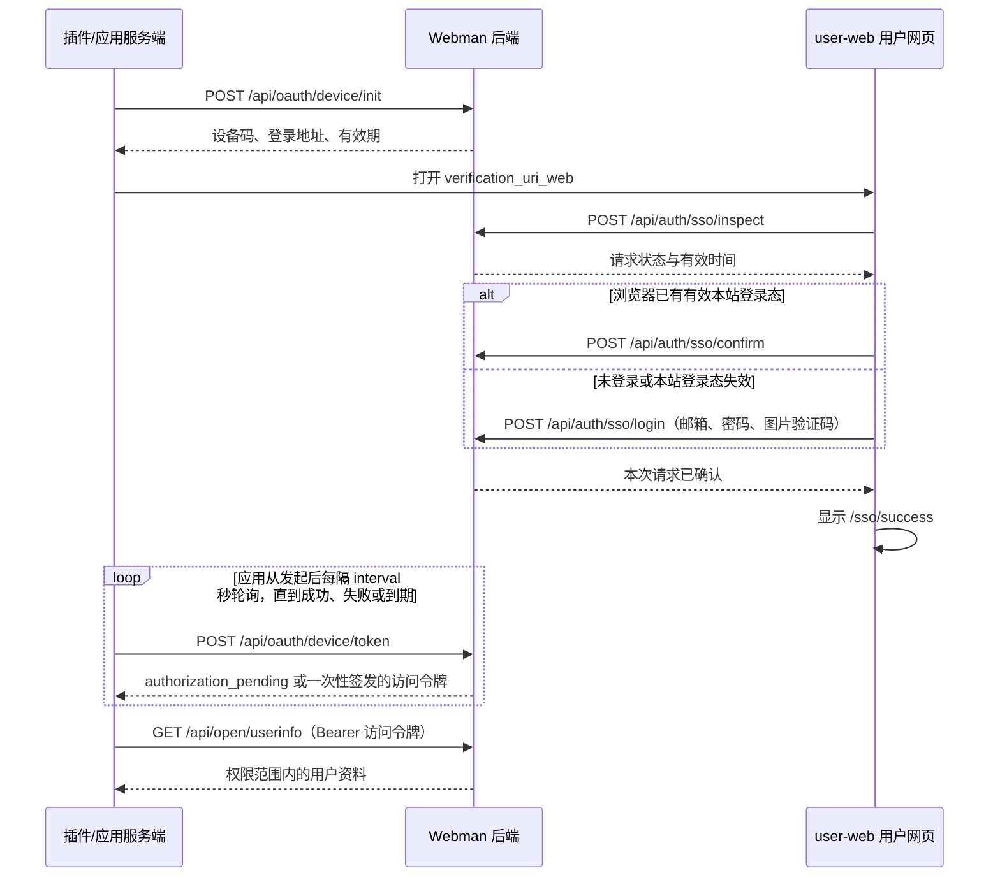

# 用户侧 SSO 登录接入流程

更新时间：2026-10-19。

本文说明当前 Webman 后端与 `web/user-web` 使用的设备码 SSO。流程为：应用发起请求，用户在网页确认身份，应用轮询领取访问令牌，再获取用户资料。

本文中的应用指接入的插件及其服务端；该流程与用户站点 `/identity/*` 下的 Hydra 身份流程分别实现。

## 1. 流程总览



应用轮询与用户在网页操作可以同时进行。用户确认后，下一次有效轮询即可领取令牌。

## 2. 接入准备

### 2.1 注册应用

在管理端“应用管理”中注册应用：

- 类型选择“插件（设备码流）”，即 `plugin`。
- 关联一个状态为 `active` 的空间。
- 配置允许访问的权限，例如 `user.basic`、`user.email`。
- 保存返回的 `client_id` 与 `client_secret`；密钥明文只在创建或重置时提供。

`client_secret` 由应用服务端保存，初始化和轮询均由该服务端调用。用户登录地址只携带本次请求 ID。

### 2.2 配置用户站点地址

后端通过 `config/userweb.php` 读取 `USER_WEB_URL`，用于生成用户登录地址。

本地默认值：

```dotenv
USER_WEB_URL=http://127.0.0.1:8081
```

部署示例：

```dotenv
USER_WEB_URL=https://user.example.com
```

这里填写用户站点根地址，不附加 `/login` 或 `/api`。修改环境配置后重启后端。

本文接口路径均以 `/api` 开头。本地后端默认地址为 `http://127.0.0.1:8787`；用户网页通过其 API 代理访问后端。

## 3. 应用发起登录

应用服务端调用：

```http
POST /api/oauth/device/init
Content-Type: application/json
```

```json
{
  "client_id": "YOUR_CLIENT_ID",
  "client_secret": "YOUR_CLIENT_SECRET"
}
```

成功返回 HTTP 200。以下 ID 和令牌均为示例占位值，实际使用接口返回值：

```json
{
  "msg": "ok",
  "data": {
    "device_code": "BBBBBBBBBBBBBBBBBBBBBBBBBBBBBBBBBBBBBBBBBBB",
    "user_code": "123456",
    "sso_request_id": "AAAAAAAAAAAAAAAAAAAAAAAAAAAAAAAAAAAAAAAAAAA",
    "verification_url": "/oauth/device",
    "verification_uri_web": "http://127.0.0.1:8081/login?ssoRequestId=AAAAAAAAAAAAAAAAAAAAAAAAAAAAAAAAAAAAAAAAAAA",
    "expires_in": 600,
    "interval": 5
  }
}
```

| 字段 | 含义 | 使用方 |
| --- | --- | --- |
| `device_code` | 本次请求的设备码，用于领取令牌 | 应用服务端 |
| `user_code` | 六位用户码，供原有手动输入设备码流程使用 | 使用手动验证入口的用户 |
| `sso_request_id` | 用户网页登录使用的请求 ID | user-web |
| `verification_uri_web` | 完整的 user-web 登录地址 | 应用打开给用户 |
| `verification_url` | 原有设备码验证入口 `/oauth/device` | 使用原有验证页的接入方 |
| `expires_in` | 请求从创建起的有效秒数，当前为 600 秒 | 应用服务端 |
| `interval` | 建议轮询间隔秒数，当前为 5 秒 | 应用服务端 |

接入 user-web 时直接打开 `data.verification_uri_web`。应用保存本次 `device_code`，用于后续轮询；不要把其他登录请求的设备码混用。

## 4. 用户在网页确认身份

用户打开的地址格式为：

```text
http://127.0.0.1:8081/login?ssoRequestId=<本次请求ID>
```

以下请求由 user-web 自动完成，应用服务端只需打开登录地址并继续轮询。

### 4.1 检查请求

```http
POST /api/auth/sso/inspect
Content-Type: application/json
```

```json
{
  "ssoRequestId": "AAAAAAAAAAAAAAAAAAAAAAAAAAAAAAAAAAAAAAAAAAA"
}
```

响应示例：

```json
{
  "msg": "ok",
  "data": {
    "ssoRequestId": "AAAAAAAAAAAAAAAAAAAAAAAAAAAAAAAAAAAAAAAAAAA",
    "status": "pending",
    "expiresAt": 1792368600000,
    "serverTime": 1792368000000
  }
}
```

`expiresAt` 与 `serverTime` 均为毫秒时间戳。`pending` 表示待确认，`completed` 表示已确认且请求尚未被领取或撤销。

请求不存在、过期、已领取或被撤销时返回 404。缺少合法请求 ID 的入口不会继续 SSO 登录。

### 4.2 已有有效本站登录态

浏览器使用当前本站令牌自动确认：

```http
POST /api/auth/sso/confirm
Content-Type: application/json
Authorization: Bearer <本站登录令牌>
```

```json
{
  "ssoRequestId": "AAAAAAAAAAAAAAAAAAAAAAAAAAAAAAAAAAAAAAAAAAA"
}
```

已有登录态失效时，网页清除匹配的旧令牌并显示密码表单。

### 4.3 未登录或本站登录态失效

用户填写邮箱、密码，点击“继续”进入图片验证码步骤，再提交登录。

网页通过 `POST /api/auth/captcha/challenges` 获取图片挑战，并将挑战 ID 与用户答案一同提交：

```http
POST /api/auth/sso/login
Content-Type: application/json
```

```json
{
  "ssoRequestId": "AAAAAAAAAAAAAAAAAAAAAAAAAAAAAAAAAAAAAAAAAAA",
  "email": "member@example.com",
  "password": "YOUR_PASSWORD",
  "captcha": {
    "challengeId": "CURRENT_CAPTCHA_CHALLENGE_ID",
    "answer": "abcd"
  }
}
```

当前后端的 `captcha` 字段为可选；网页取到图片挑战后会携带该字段，后端校验已提交的挑战。验证码错误或过期返回 422，网页换图并保留错误提示，允许重输。

### 4.4 确认完成

密码登录与已有登录态确认成功时，均返回：

```json
{
  "msg": "ok",
  "data": {
    "status": "completed",
    "ssoRequestId": "AAAAAAAAAAAAAAAAAAAAAAAAAAAAAAAAAAAAAAAAAAA"
  }
}
```

后端将本次请求关联到已验证的用户，保存应用授权关系，并标记请求已确认。

网页随后进入 `/sso/success`，显示“登录成功”“正在返回应用”，五秒后尝试关闭页面。浏览器不允许自动关闭时，会提示手动关闭并返回应用。

SSO 密码确认只完成本次应用授权，不签发或保存新的 user-web 本站登录令牌。成功页的浏览器展示记录也不作为应用登录凭据；应用通过下一节的轮询结果取得凭据。

## 5. 应用轮询领取访问令牌

应用从发起登录后，按 `interval` 间隔调用：

```http
POST /api/oauth/device/token
Content-Type: application/json
```

```json
{
  "client_id": "YOUR_CLIENT_ID",
  "client_secret": "YOUR_CLIENT_SECRET",
  "device_code": "BBBBBBBBBBBBBBBBBBBBBBBBBBBBBBBBBBBBBBBBBBB"
}
```

### 5.1 用户尚未确认

接口返回 HTTP 200，响应体为：

```json
{
  "error": "authorization_pending"
}
```

这是等待状态，继续按间隔轮询。此响应没有 `msg`、`data` 包络。

### 5.2 用户已确认

接口返回 HTTP 200：

```json
{
  "msg": "ok",
  "data": {
    "access_token": "ISSUED_ACCESS_TOKEN",
    "token_type": "Bearer",
    "expires_in": 36000,
    "scope": "user.basic user.email"
  }
}
```

应用保存 `data.access_token`，并立即停止本次轮询。令牌有效期以响应中的 `expires_in` 为准，`scope` 为实际授予的权限，以空格分隔。

设备码只允许成功领取一次。领取时设备请求及其索引被删除，再次领取会返回 400；请求的十分钟有效期从创建时计算，不会因用户确认而重新开始。

应用应按以下顺序处理轮询结果：

1. `error` 为 `authorization_pending`：等待 `interval` 秒后继续。
2. 成功响应包含 `data.access_token`：保存令牌，停止轮询，获取用户资料。
3. 请求过期、撤销或设备码已被使用：停止本次轮询，重新发起登录。
4. 应用凭据错误或应用停用：停止轮询，处理应用配置问题。
5. 临时网络失败：在请求剩余有效期内延迟重试，避免密集请求。

## 6. 获取用户资料并完成应用登录

应用服务端使用取得的令牌调用：

```http
GET /api/open/userinfo
Authorization: Bearer <access_token>
```

具有 `user.basic` 和 `user.email` 权限时，响应示例为：

```json
{
  "msg": "ok",
  "data": {
    "id": 42,
    "username": "示例用户",
    "avatar": "/app/user/default-avatar.png",
    "email": "member@example.com"
  }
}
```

应用根据返回的用户 ID 关联自己的用户记录并建立登录状态。邮箱等附加字段仅在具备对应权限时返回。

后端会检查令牌、会话、应用状态及用户的应用授权关系。访问令牌失效返回 401，应用需要重新发起登录。

## 7. 管理端查看与撤销

管理端“设备 / SSO 授权请求”页面路径为 `/sso-requests`，每十秒刷新一次列表。

| 操作 | 后端接口 |
| --- | --- |
| 查询活跃请求 | `GET /api/admin/sso-requests` |
| 撤销指定请求 | `POST /api/admin/sso-requests/{deviceCode}/revoke` |

管理接口需要平台管理员登录态。列表包含应用、用户码、确认用户、状态和剩余有效期。

| 请求状态 | 含义 | 后续行为 |
| --- | --- | --- |
| `pending` | 用户尚未确认 | 应用轮询得到 `authorization_pending` |
| `authorized` | 用户已确认，应用尚未领取 | 应用可领取一次令牌 |
| 已领取 | 请求已被消费并从列表移除 | 应用使用已取得的令牌 |
| 已撤销或已过期 | 请求已失效并从列表移除 | 需要重新发起登录 |

网页检查接口把 `authorized` 对应为 `completed`，两者表示同一确认结果在不同接口中的状态名。

撤销尚未领取的请求后，浏览器确认和应用领取均无法继续。该页面撤销的是本次登录请求；已经签发的访问令牌，需要通过会话管理、撤销应用授权或停用应用等方式处理。

## 8. 常见失败与处理

失败响应通常为 HTTP 4xx 加中文 `msg`：

```json
{
  "msg": "SSO 请求不存在或已过期"
}
```

| 场景 | 接口与状态 | 处理方式 |
| --- | --- | --- |
| 应用不存在、停用、类型错误或密钥错误 | 初始化或领取：401 | 检查应用类型、状态和凭据 |
| 设备码属于其他应用 | 领取：400 | 使用发起该请求的应用凭据；错误应用不会消费该设备码 |
| 请求不存在、已过期、已领取或被撤销 | 网页检查、登录或确认：404 | 从应用重新发起登录 |
| 请求已确认，重复提交确认 | 网页登录或确认：409 | 尚未领取时可显示完成状态，应用继续领取；并发失效时重新发起 |
| 确认时应用已停用，或请求在处理期间失效 | 网页登录或确认：409 | 结束当前请求，处理应用状态或重新发起 |
| 本站登录态失效 | 已有登录态确认：401 | 清除匹配的旧登录态，改用邮箱和密码 |
| 邮箱或密码错误 | SSO 密码登录：400 | 提示用户修改后重试 |
| 账号被禁用 | SSO 密码登录或已有登录态确认：403 | 无法继续授权 |
| 图片验证码错误或过期 | SSO 密码登录：422 | 获取新图片并重新输入 |
| 设备码过期、被撤销或已领取 | 应用领取：400 | 停止本次轮询，重新发起 |
| 已签发令牌过期、会话或授权被撤销 | 获取用户资料：401 | 重新发起登录 |

登录页成功后仍需等待应用完成令牌领取。当前流程由应用轮询完成结果交付，不通过回调 URL 传递令牌。

## 9. 相关实现

- `config/userweb.php`：用户站点地址配置。
- `app/oauth/DeviceController.php`：设备码初始化、轮询领取与原有用户码确认。
- `app/oauth/SsoController.php`：网页请求检查、密码登录与已有会话确认。
- `app/common/services/OAuthService.php`：设备请求状态、一次性消费与撤销。
- `app/common/services/SessionService.php`：访问令牌及会话签发。
- `app/common/middleware/OAuthTokenAuth.php`：开放接口的访问令牌校验。
- `app/open/OAuthUserController.php`：按权限返回用户资料。
- `app/admin/SsoController.php`：管理端请求列表与撤销。
- `web/user-web/apps/web/src/auth/AuthFlow.tsx`：用户网页登录流程。
- `web/user-web/apps/web/src/pages/AuthPage/SsoSuccess.tsx`：成功页与关闭提示。
